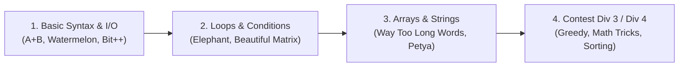

# 💻 Beginner Competitive Programming Solutions (C & C++)

)

  <b>A foundational repository containing solutions to beginner-friendly competitive programming challenges from Codeforces, Beecrowd, and university contests.</b>

---

## 📌 About This Repository

This repository tracks the initial journey into competitive programming. It contains well-structured solutions in **C** and **C++** covering fundamental algorithmic patterns such as loops, conditional branching, array traversals, basic mathematical reasoning, and string manipulation.

---

## 🧭 Problem Solving Progression

---

## 📂 Highlights of Included Solutions

- **Arithmetic & Simulation**: `watermelon.c`, `theatresquare.c`, `calculatingfunction.c`, `elephant.c`
- **String Manipulation**: `waytoolongword.c`, `stringtask.c`, `presents.c`, `capslock.c`
- **Logic & Implementation**: `beautifulmatrix.c`, `nextround.c`, `antonandpolyhedrion.c`, `dubstep.c`
- **Contest Practice**: Round 952 (Div 4) problem sets, university lab exams, and practice contests.

---

## 👨‍💻 Author

**Momin Rifat**  
GitHub: [@MominRifat](https://github.com/MominRifat)
